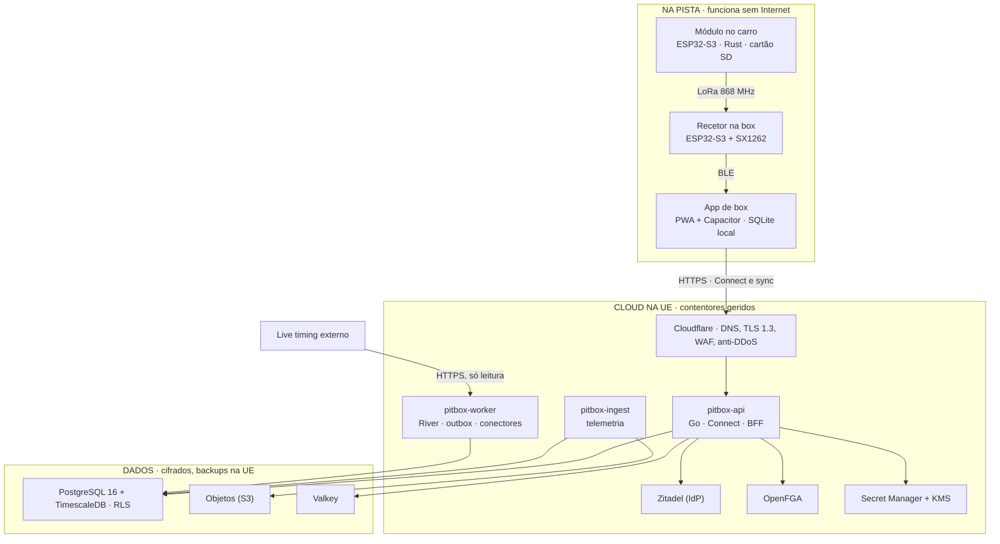

# PitBox — Arquitetura Técnica

Oct 11, 2026 · @Nelson Freitas

## 1. Princípios e decisões de topo

A arquitetura é um monólito modular em Go, com contratos gRPC/Connect, PostgreSQL e uma app offline-first, desenhada para se dividir em serviços só quando houver razão para isso. Este documento implementa a especificação funcional do PitBox.

**Princípios**

1. **A box nunca depende da rede.** Tudo o que é usado durante uma corrida corre no dispositivo; o servidor é para sincronizar, guardar e analisar.
2. **Começar simples, com fronteiras certas.** Um binário Go com módulos isolados por domínio, cada um com o seu esquema na base de dados e o seu serviço gRPC. Separar um módulo num microserviço é uma mudança de deploy, não uma reescrita.
3. **Segurança por omissão.** Autorização em cada chamada, isolamento por equipa na base de dados, segredos fora do código, imagens assinadas.
4. **Contratos primeiro.** Os ficheiros `.proto` são a fonte de verdade para a API, a app e o firmware.
5. **Operar barato.** Serviços geridos onde poupam trabalho (base de dados, identidade, armazenamento), custo mensal previsível.

**Decisões de topo**

| Decisão | Escolha | Porquê | Alternativa considerada |
| --- | --- | --- | --- |
| Linguagem do backend | Go 1.27 | Ecossistema cloud-native, gRPC de primeira classe, binário único | .NET, Node (experiência existente) |
| Estilo de API | Connect v2 (connect-go) sobre Protobuf | Fala gRPC, gRPC-Web e HTTP/JSON com o mesmo código; funciona no browser sem proxy | gRPC puro + Envoy para gRPC-Web |
| Forma do backend | Monólito modular | Equipa de 1–2 pessoas; microserviços só aumentariam o custo operacional | Microserviços desde o início |
| App | PWA em TypeScript (React + Vite) + Capacitor para as lojas | Um código para web, Android e iOS; acesso a vibração, Bluetooth e ecrã sempre ligado via Capacitor | Flutter, React Native |
| Base de dados | PostgreSQL 16 + TimescaleDB para telemetria | Uma tecnologia para dados relacionais e séries temporais | Postgres + InfluxDB |
| Identidade | Zitadel (gerido ou self-hosted) | OIDC, passkeys, MFA, organizações; open-source, alojamento na UE | Keycloak, Auth0 |
| Firmware | Rust (esp-hal + Embassy) em ESP32-S3 | Segurança de memória, async eficiente, ecossistema esp-rs maduro | C++ com ESP-IDF |
| Infraestrutura | Kubernetes gerido (fase 2); Cloud Run na fase 1 (ADR 0008) | Começar sem operar cluster; migrar quando houver necessidade | Fly.io, VM única com Docker Compose |

## 2. Visão de contexto e de contentores

O sistema tem dois mundos: a pista, onde tudo funciona sem Internet, e a cloud na UE, que sincroniza, guarda e analisa. Entre eles só passa HTTPS através da Cloudflare.



A app é o centro: recebe a telemetria do recetor por BLE, trabalha na base local e sincroniza com o `pitbox-api` quando há rede. O `pitbox-worker` é o único processo que fala com sites externos de live timing.

| Contentor | Tecnologia | Responsabilidade |
| --- | --- | --- |
| App de box | TypeScript, React, Capacitor, SQLite | Toda a interface; funciona offline |
| Módulo no carro | Rust, ESP32-S3 | Aquisição e gravação de telemetria |
| Recetor na box | Rust, ESP32-S3 + SX1262 | Recebe LoRa e entrega à app por BLE |
| pitbox-api | Go, Connect | API, BFF web, regras de negócio, sync |
| pitbox-worker | Go, River | Tarefas assíncronas, eventos, conectores de timing |
| pitbox-ingest | Go | Processamento de ficheiros de telemetria |
| Zitadel | Serviço gerido | Identidade dos utilizadores |
| OpenFGA | Go (open-source) | Decisões de autorização |
| PostgreSQL + TimescaleDB | Gerido | Dados de negócio e séries de telemetria |
| Armazenamento de objetos | S3 compatível | Ficheiros brutos, fotografias, exportações |
| Valkey | Gerido | Sessões web, cache, rate limiting |

## 3. App de box (PWA offline-first)

A app guarda tudo localmente numa base SQLite no dispositivo e trata o servidor como um destino de sincronização; a interface lê sempre da base local.

**Stack**

| Camada | Tecnologia |
| --- | --- |
| Linguagem | TypeScript (strict) |
| UI | React 19 + Vite; componentes acessíveis (Radix UI) + Tailwind CSS |
| Rotas e dados | TanStack Router + TanStack Query |
| Base local | SQLite via wa-sqlite (OPFS) no browser; plugin SQLite nativo no Capacitor |
| Cliente API | @connectrpc/connect-web gerado a partir dos `.proto` (Buf) |
| Offline | Service Worker (Workbox) para os ficheiros da app; fila de escrita própria em SQLite |
| Nativo | Capacitor: vibração, ecrã sempre ligado, notificações locais, Bluetooth LE (módulo), armazenamento seguro, biometria |
| Gráficos | uPlot (séries longas de telemetria) e Recharts (resumos) |
| Testes | Vitest, Testing Library, Playwright (E2E, incluindo modo avião) |

**Organização por funcionalidade**

- `features/setups`, `features/engines`, `features/events`, `features/final`, `features/telemetry`, `features/auth`
- Cada funcionalidade tem: repositório local (SQL), serviço de domínio, ecrãs; nenhum ecrã chama a API diretamente

**Modo final**

- Estado da corrida numa máquina de estados explícita (XState): pronta → em curso → em box → em curso → terminada; flameout e avaria como transições
- Cálculo do aviso de reabastecimento local e determinístico, coberto por testes de propriedades
- Wake Lock + Capacitor KeepAwake; nenhum pedido de rede no caminho crítico de um toque

**Segurança no cliente**

- Tokens em armazenamento seguro do sistema (Keychain / Android Keystore); na web, sessão via BFF com cookie HttpOnly, SameSite=Strict (secção 5)
- Base local cifrada com chave guardada no armazenamento seguro (SQLCipher no nativo)
- Content Security Policy estrita, sem scripts inline; dependências verificadas no CI
- Nenhum segredo da plataforma no bundle da app

## 4. Backend em Go: módulos, API e contratos

O backend é um único binário `pitbox-api` com módulos de domínio isolados, mais dois processos auxiliares: `pitbox-worker` (tarefas assíncronas) e `pitbox-ingest` (telemetria). Os três partilham o mesmo repositório e os mesmos contratos.

### 4.1 Módulos de domínio

| Módulo | Serviço Connect | Esquema SQL | Responsabilidade |
| --- | --- | --- | --- |
| identity | `TeamService`, `MemberService` | `identity` | Equipas, membros, convites, papéis (utilizadores vivem no IdP) |
| garage | `CarService`, `EngineService`, `TyreService`, `PartService` | `garage` | Carros, motores, pneus, peças, stock, contadores |
| setup | `SetupService` | `setup` | Fichas versionadas, comparação, partilha |
| maintenance | `MaintenanceService` | `maintenance` | Intervenções, regras, checklists |
| events | `EventService`, `SessionService` | `events` | Provas, horário, sessões, resultados, finais e paragens |
| timing | `TimingService` | `timing` | Conectores de live timing, importação, correspondência de transponders |
| analytics | `AnalyticsService` | (leitura) | Consultas de análise sobre os outros esquemas via vistas |
| telemetry | `TelemetryService`, `DeviceService` | `telemetry` | Módulos, emparelhamento, sessões de telemetria, séries |
| sync | `SyncService` | `sync` | Receber filas de alterações e devolver alterações desde um cursor |

- Regra de isolamento: um módulo só acede às suas tabelas; para dados de outro módulo usa a interface Go desse módulo ou um evento. O CI falha se um pacote importar o `internal/` de outro módulo (verificação com go-arch-lint)
- Comunicação assíncrona entre módulos por eventos de domínio gravados numa tabela outbox na mesma transação e processados pelo `pitbox-worker` (River, fila sobre Postgres); sem broker externo na fase 1

### 4.2 Camadas dentro de cada módulo

1. **Transporte** — handler Connect gerado; só converte mensagens e chama o serviço
2. **Aplicação** — casos de uso; aqui se verifica a autorização e se abre a transação
3. **Domínio** — entidades e regras puras (cálculo de relação, regras de manutenção, estratégia de box), sem dependências externas
4. **Persistência** — consultas SQL geradas com sqlc sobre pgx

### 4.3 Contratos

- Protobuf em `proto/pitbox/<módulo>/v1/*.proto`, gerido com Buf: lint, `buf breaking` contra a branch principal em cada PR
- Validação declarativa com protovalidate (intervalos, formatos, obrigatórios), aplicada por interceptor antes do handler
- Versão no pacote (`v1`, `v2`); campos nunca reutilizados; remoções só com `reserved`
- Paginação por cursor opaco em todas as listas; máximo de 200 itens por página
- Idempotência: todas as escritas aceitam `request_id` (UUIDv7) guardado durante 7 dias
- Erros: códigos Connect/gRPC padrão; mensagens sem informação interna. Só um `*connect.Error` escrito de propósito chega ao cliente; qualquer outro erro vira `Internal` com a mensagem fixa "internal error" e a causa fica no log (ADR 0012)
- Erros de validação: detalhe `buf.validate.Violations` (caminho do campo e `rule_id`, nunca o valor enviado), tal como o interceptor do protovalidate o devolve; a app traduz por `rule_id`. Não se converte para `google.rpc.BadRequest`
- Leituras novas declaram `option idempotency_level = NO_SIDE_EFFECTS;`; sem essa marca, um RPC conta como escrita (auditoria)

### 4.4 Interceptors (ordem)

Implementam-se como `connect.ServerInterceptor` (Connect v2, ADR 0012) e passam-se a `connect.NewServer` por esta ordem: o primeiro é o mais externo.

1. OpenTelemetry (trace, métricas): o mais externo, para o `trace_id` estar no contexto de todos os logs abaixo (o do panic incluído) e o span receber o erro final (decisão do F1-02; a recuperação vem logo a seguir)
2. Recuperação de panics
3. Erros: mensagem pública fixa para erros internos e uma linha de log por RPC (dentro da recuperação, fora de tudo o resto, para apanhar as recusas dos passos 5 a 7)
4. Limites: deadline (30 s nos unários, 55 min nos streams, configuráveis para baixo; o limite de **tamanho** é do transporte: 4 MiB por mensagem nos dois sentidos, também depois de descomprimir; 32 MiB só na ingestão de telemetria, que é outro processo)
5. Autenticação: sessão do BFF (cookie) e construção do principal (F1-03)
6. Rate limiting por utilizador e por equipa (F1-04b, ADR 0014): três camadas — token bucket local em memória, GCRA atómico no Valkey e circuit breaker. Pedidos acima da quota são rejeitados antes da validação. Endpoints públicos falham fechados quando o Valkey não está disponível.
7. Validação (protovalidate), com o validador compilado no arranque
8. Contexto de auditoria nas escritas (`AuditMeta`: trace id, IP do peer e user agent); a linha em `audit.audit_log` escreve-se na transação do caso de uso

Os RPCs são traçados só pelo `otelconnect`, que não confia no `traceparent` do cliente; o middleware HTTP exclui as rotas dos serviços para não haver dois spans por RPC. A reflection (`grpcreflect`) só se monta com `PITBOX_ENV=local`.

### 4.5 Bibliotecas Go

| Função | Biblioteca |
| --- | --- |
| API | connectrpc.com/connect/v2 (+ `connecthttp`), validate, otelconnect, grpchealth/v2, grpcreflect/v2 (ADR 0012) |
| Postgres | jackc/pgx v5 + sqlc |
| Migrações | Atlas Community: SQL escrito à mão, `atlas.sum`, teste de desvio contra `schema.sql` e lint por script (ADR 0010) |
| Fila de tarefas | riverqueue/river |
| OIDC | coreos/go-oidc v3 + golang.org/x/oauth2 (login e ID token). `lestrrat-go/jwx` só se o F2-06 (Bearer) o exigir (ADR 0013) |
| Valkey | valkey-io/valkey-go (sessões BFF, locks, rate limiting; sem `valkeylock`) |
| Autorização | OpenFGA Go SDK (secção 6) |
| Configuração | variáveis de ambiente + caarlos0/env; segredos do gestor de segredos |
| Logs | log/slog (JSON) |
| Observabilidade | go.opentelemetry.io/otel |
| Testes | testing, testify, testcontainers-go, go-cmp |

## 5. Identidade e autenticação

Utilizadores autenticam-se no Zitadel por OIDC com PKCE; o backend nunca vê palavras-passe e só aceita tokens de vida curta emitidos para a sua audiência. Módulos de telemetria têm identidade própria, separada dos utilizadores.

### 5.1 Utilizadores

- **IdP**: Zitadel, alojado na UE; passkeys, TOTP, verificação de palavras-passe comprometidas, política de bloqueio e emails transacionais configurados lá
- **Web**: padrão BFF. O `pitbox-api` faz o fluxo Authorization Code + PKCE (S256) como cliente confidencial; o estado do pré-login vai num cookie cifrado (`__Host-pitbox_login`, Lax) e a sessão no Valkey, com o cookie `__Host-pitbox_session` (HttpOnly, Secure, SameSite=Strict) a guardar só um valor aleatório (no Valkey fica o SHA-256). A sessão guarda identificadores e o refresh token cifrado; nenhum token no JavaScript (ADR 0013)
- **Android/iOS (Capacitor)**: Authorization Code + PKCE com o browser do sistema (AppAuth); tokens no Keychain/Keystore
- **Tokens**: ID token validado no login (`go-oidc`, algoritmo fixo em `PITBOX_OIDC_ALLOWED_ALGS`, por omissão ES256 configurado nas *web keys* do Zitadel); access token de 10 min, ID token de 5 min, refresh token com 168 h de inatividade e 720 h absolutas. O Zitadel rota o refresh token mas **não revoga a família** se um antigo for reutilizado (ADR 0004, emenda)
- **Validação no backend** (BFF): a API autentica pela sessão do cookie. O ID token é verificado no callback: assinatura, `iss`, `aud`, `exp` (sem tolerância), `nbf` (tolerância fixa de 5 min do `go-oidc`) e `nonce` (à mão). O JWKS é pedido pelo `go-oidc`, que não tem TTL (só volta ao JWKS numa falha); isto só é aceitável enquanto o único JWT validado vier do endpoint de tokens. O caminho `Authorization: Bearer` (telemóvel) fica no F2-06
- **Principal interno**: `{user_id, session_id, amr, auth_time}` lido da **sessão**, não do token (`auth_time`, `amr` e `sid` só existem no ID token); as equipas e papéis não vêm da sessão, são verificados no motor de autorização
- **Utilizador desativado**: o access token de 10 min é a janela de revogação. No refresh seguinte o Zitadel recusa (`invalid_grant`, ou `invalid_request` com `Errors.User.*`) e a sessão acaba; uma falha do Zitadel ou do Valkey nunca desloga (`UNAVAILABLE`, graça de 2 min)
- **Operações sensíveis** (F1-03c) exigem `auth_time` ≤ 5 min e `amr` com fator forte (lidos da sessão, renovados por reautenticação com `prompt=login`); caso contrário a API devolve `UNAUTHENTICATED` com pedido de reautenticação (step-up). OTP por SMS e por email estão desligados no Zitadel: dão `amr` `mfa` e estragariam esta regra

### 5.2 Modo box offline

1. Antes da prova, a app pede um **passe offline** ao `SyncService`: um token assinado pelo servidor com `team_id`, `device_id`, papel e validade de 72 h
2. Sem rede, a app autoriza localmente as ações com base nesse passe e assina cada entrada da fila com uma chave do dispositivo (ECDSA P-256, gerada no armazenamento seguro, chave pública registada no servidor)
3. Ao sincronizar, o servidor verifica a assinatura de cada entrada, o passe e as permissões atuais; entradas de um dispositivo revogado são rejeitadas e ficam para revisão do dono da equipa

### 5.3 Módulos de telemetria

- Emparelhamento: a app pede ao `DeviceService` um código de emparelhamento de uso único (5 min), passa-o ao módulo por BLE; o módulo gera um par de chaves no seu armazenamento seguro e envia um CSR; o servidor devolve um certificado de cliente X.509 de 90 dias com `device_id` e `team_id`
- Envio: mTLS com esse certificado quando o módulo envia por Wi-Fi; pacotes LoRa autenticados com chave simétrica de sessão derivada no emparelhamento (secção 9)
- Rotação automática aos 60 dias; revogação imediata ao desemparelhar (lista de revogação verificada pelo `pitbox-ingest`)

### 5.4 Contas de serviço

- Processos internos (worker, ingest) autenticam-se na base de dados e no armazenamento com identidade de workload da cloud (sem chaves estáticas)
- Na fase Kubernetes, identidade de serviço SPIFFE e mTLS entre processos (secção 12)

## 6. Autorização

A autorização tem duas barreiras independentes: o OpenFGA decide se o utilizador pode fazer a ação naquele recurso, e o Row-Level Security do PostgreSQL garante que nenhuma consulta devolve dados de outra equipa, mesmo com um bug no código.

### 6.1 Modelo de relações (OpenFGA)

```
model
  schema 1.1

type user

type team
  relations
    define owner: [user]
    define mechanic: [user] or owner
    define pilot: [user]
    define member: mechanic or pilot

type car
  relations
    define team: [team]
    define viewer: member from team
    define editor: mechanic from team

type setup
  relations
    define team: [team]
    define shared_with: [user, user:*]
    define viewer: member from team or shared_with
    define editor: mechanic from team
    define annotator: member from team
```

- O mesmo padrão aplica-se a `engine`, `tyre_set`, `event`, `session`, `device`
- Cada caso de uso chama `Check(user, relation, object)` antes de tocar nos dados; listas usam `ListObjects` ou filtram por equipa já verificada
- Testes de autorização: um ficheiro de asserções OpenFGA por tipo, corrido no CI; e um teste de integração por endpoint com um utilizador de outra equipa, que tem de receber `PERMISSION_DENIED` ou `NOT_FOUND`

### 6.2 Isolamento na base de dados (RLS)

- Todas as tabelas com dados de equipa têm `team_id NOT NULL`
- A aplicação liga-se com um papel sem `BYPASSRLS` (verificado em cada ligação: membro de `pitbox_app`, nunca superutilizador, `BYPASSRLS` nem membro de `pitbox_owner`); cada caso de uso corre em `db.WithTeamTx` (ou `WithTeamReadTx`, nos RPCs `NO_SIDE_EFFECTS`), depois de `authz.Check`. A transação define `app.user_id` e `app.team_id` com `set_config(…, true)` (parâmetros, nunca texto concatenado), confirma na tabela `membership` que o utilizador pertence à equipa (senão `ErrNotMember`, que sai como `NOT_FOUND`) e só então corre a função, que recebe a interface estreita `db.DBTX` e não pode fazer `Commit`
- Política: `USING (team_id = app.current_team_id())` para leitura e escrita; um contexto vazio não vê nada e um malformado dá erro
- O contexto é uma variável de sessão: só `platform/db` a escreve, e um teste de arquitetura recusa SQL de contexto (Go e `.sql` do `sqlc`) noutro sítio (ADR 0005, emenda)
- Migrações correm com outro papel; um teste no CI falha se alguma tabela com `team_id` não tiver RLS ativo
- Escritas de auditoria de equipa (`audit.RecordTeam`) vão na mesma transação, com a equipa e o autor lidos do contexto da própria transação

### 6.3 Links de partilha

- Token aleatório de 256 bits; guardado apenas o hash (SHA-256)
- Ligação a um único setup, só leitura, com validade e revogável
- Endpoint público separado, com rate limiting próprio e resposta idêntica para tokens inexistentes e expirados

### 6.4 Administração da plataforma

- Papéis administrativos só no IdP, com MFA por passkey obrigatório
- Acesso a dados de uma equipa só através de uma concessão temporária (`support_grant`, máx. 24 h) ligada a um pedido de suporte, registada na auditoria e visível ao dono da equipa

## 7. Modelo de dados e armazenamento

Um único PostgreSQL 16 gerido guarda os dados de negócio (um esquema por módulo) e a telemetria em hypertables TimescaleDB; ficheiros brutos e fotografias vão para armazenamento de objetos.

### 7.1 Armazenamento

| Dados | Onde | Notas |
| --- | --- | --- |
| Negócio (equipas, garagem, setups, provas) | PostgreSQL 16, esquema por módulo | Gerido (ex.: Neon, Crunchy Bridge, Cloud SQL, RDS) na UE; réplica de leitura na fase 2 |
| Telemetria em séries | Extensão TimescaleDB, esquema `telemetry` | Hypertable com retenção de 24 meses; **sem compressão** enquanto houver RLS (ADR 0011); agregações contínuas por volta e por segundo (com acesso por vista `security_barrier`, ADR 0011) |
| Ficheiros de telemetria brutos, fotografias, exportações | Armazenamento de objetos compatível S3 (ex.: Cloudflare R2, Scaleway, S3 eu-west) | Cifrado; URLs pré-assinados de 5 min; lifecycle de 24 meses para brutos |
| Sessões web, rate limiting, cache | Valkey (compatível Redis) | Sem dados que não possam ser perdidos |
| Relações de autorização | OpenFGA com armazenamento no mesmo Postgres (esquema `fga`) | Papel de base de dados próprio |

### 7.2 Entidades principais

| Entidade | Chaves e campos principais | Notas |
| --- | --- | --- |
| team | id, name, category, created\_at | Raiz do isolamento |
| membership | team\_id, user\_id, role, invited\_by, joined\_at | Espelhado no OpenFGA |
| car | id, team\_id, make, model, serial, transponder, status |  |
| engine | id, team\_id, make, model, serial, tanks\_total, minutes\_total | Contadores atualizados por eventos |
| engine\_mount | engine\_id, car\_id, from\_ts, to\_ts | Histórico motor ↔ carro |
| tyre\_set | id, team\_id, label, make, compound, insert, glued\_at, sessions\_total |  |
| part / stock\_item | id, team\_id, kind, ref, qty, min\_qty, unit\_cost |  |
| setup | id, team\_id, car\_id, name, current\_version | Ficha “viva” |
| setup\_version | setup\_id, version, values (JSONB), schema\_version, created\_by, created\_at | Imutável; valores validados por esquema JSON versionado |
| event | id, team\_id, name, track\_id, starts\_on, ends\_on, timing\_provider, timing\_ref |  |
| session | id, team\_id, event\_id, kind, scheduled\_at, car\_id, engine\_id, tyre\_set\_id, setup\_version\_id, conditions (JSONB) |  |
| lap | session\_id, lap\_no, time\_ms, position, source | Importado ou manual |
| pit\_stop | session\_id, seq, kind, in\_ts, out\_ts, lap\_no | Registo só de acrescento |
| maintenance\_entry | id, team\_id, target\_kind, target\_id, kind, parts (JSONB), notes, at |  |
| maintenance\_rule | id, team\_id, target\_kind, metric, limit, action |  |
| device | id, team\_id, car\_id, cert\_serial, fw\_version, status |  |
| telemetry\_sample | device\_id, session\_id, ts, head\_temp\_c, rpm, rx\_volt, ax, ay, az | Hypertable, chave (device\_id, ts) |
| audit\_log | id, team\_id, actor, action, object, before, after, at | Só acrescento; cópia para armazenamento imutável |

### 7.3 Convenções

- Identificadores UUIDv7 gerados no cliente (permite criar registos offline sem colisões e ordenar por tempo)
- Todas as tabelas com `created_at`, `updated_at`, `version` (inteiro, para concorrência otimista) e `deleted_at` (apagamento lógico, purga ao fim de 30 dias)
- Valores de setup em JSONB com esquema versionado, para permitir campos personalizados por equipa sem migrações; os campos usados em análises são extraídos para colunas geradas indexadas
- Unidades no nome das colunas (`_ms`, `_c`, `_mm`, `_deg`)
- Migrações só compatíveis para a frente (expand/contract): adicionar, migrar dados, mudar o código, só depois remover

### 7.4 Cifra

- Em trânsito: TLS 1.3 entre a API e a base de dados (`sslmode=verify-full`)
- Em repouso: cifra do disco do fornecedor; campos sensíveis (notas privadas, emails de convite) com cifra por envelope via KMS

## 8. Sincronização offline

A sincronização é um protocolo próprio e simples sobre o `SyncService`: o dispositivo envia operações pendentes e recebe tudo o que mudou desde o seu último cursor. Construí-lo de raiz em vez de usar um motor de sync genérico mantém a autorização no servidor sob controlo total.

### 8.1 Protocolo

```protobuf
service SyncService {
  rpc Push(PushRequest) returns (PushResponse);   // envia operações da fila local
  rpc Pull(PullRequest) returns (PullResponse);   // alterações desde um cursor
  rpc IssueOfflinePass(IssueOfflinePassRequest) returns (OfflinePass);
}

message Operation {
  string op_id = 1;          // UUIDv7, chave de idempotência
  string entity = 2;         // "setup", "pit_stop", ...
  string entity_id = 3;
  OpKind kind = 4;           // CREATE, PATCH, APPEND, DELETE
  google.protobuf.Struct fields = 5;   // só os campos alterados
  int64 base_version = 6;    // versão em que a edição se baseou
  google.protobuf.Timestamp client_ts = 7;
  bytes device_signature = 8;
}
```

### 8.2 Regras

1. **Push** processa as operações por ordem, cada uma numa transação: verifica assinatura, passe offline e autorização atual; ignora `op_id` já aplicado (idempotência)
2. **Registos de acrescento** (voltas, paragens, intervenções, notas): aplicados sempre, nunca entram em conflito
3. **Fichas editáveis**: se `base_version` = versão atual, aplica; se não, junta campo a campo; o mesmo campo alterado nos dois lados gera um registo `conflict` devolvido à app para o mecânico escolher
4. **Pull** devolve alterações por ordem de um número de sequência global por equipa (`change_seq`), em páginas de 500; o cursor é esse número
5. Apagamentos propagam-se como lápides (`deleted_at`) durante 30 dias

### 8.3 Sincronização local na box (fase 2)

- Dois dispositivos da mesma equipa trocam operações por Bluetooth LE ou rede local, com o mesmo formato `Operation` e as mesmas assinaturas
- Cada dispositivo continua a ser autoridade só das suas operações; o servidor reconcilia tudo mais tarde pelo `op_id`

## 9. Telemetria: hardware, firmware e ingestão

O módulo no carro grava tudo em cartão e envia um resumo por LoRa para um recetor na box ligado ao telemóvel por Bluetooth; a app junta os dados à sessão e envia-os para o servidor quando houver rede.

### 9.1 Hardware

| Componente | Escolha | Função |
| --- | --- | --- |
| Microcontrolador | ESP32-S3 (módulo com flash cifrável e secure boot) | Aquisição, gravação, rádio |
| Rádio | Semtech SX1262, 868 MHz | Envio para a box |
| Temperatura | Termopar tipo K + MAX31855 (SPI) | Cabeça do motor |
| Rotações | Sensor Hall + íman no volante (entrada de captura de impulsos) | RPM |
| IMU | LSM6DSO (SPI) | Aceleração e giroscópio |
| Armazenamento | microSD (SPI), formato de ficheiro próprio com blocos e CRC | Gravação completa |
| Alimentação | Da bateria do recetor, com regulador próprio, fusível e díodo; nunca partilha a linha de sinal dos servos | Isolamento do controlo do carro |
| Recetor na box | Segundo ESP32-S3 + SX1262, ligado ao telemóvel por BLE ou USB | Ponte LoRa → app |

### 9.2 Firmware em Rust

- `esp-hal` + Embassy (async, sem sistema operativo); `embedded-sdmmc`; driver `lora-phy`; `postcard` para serialização compacta
- Tarefas Embassy independentes: aquisição por sensor (cada uma à sua frequência), escrita no cartão em blocos de 4 KiB, envio LoRa, BLE para emparelhamento e descarga
- Relógio sincronizado com o telemóvel no emparelhamento e no início de cada sessão
- **Secure boot v2 e cifra da flash ativados**; firmware assinado (Ed25519) e verificado antes de instalar; anti-rollback por contador de versão
- Atualização OTA: a app descarrega o firmware assinado do servidor e passa-o por BLE; o módulo verifica a assinatura e muda de partição só se o arranque da nova versão for bem-sucedido
- Watchdog de hardware; qualquer falha reinicia só o módulo

### 9.3 Ligação LoRa

- Pacote de resumo de cerca de 24 bytes a 1 Hz: número de sequência, temperatura, RPM máxima e média do último segundo, tensão, flags de alerta
- Autenticação e cifra com ChaCha20-Poly1305 e chave de sessão derivada no emparelhamento; o número de sequência faz parte do nonce e o recetor rejeita repetições
- Banda e duty cycle: em 868 MHz a UE limita o tempo de emissão por sub-banda. Na sub-banda 869,4–869,65 MHz (10% de duty cycle), SF7/125 kHz e o pacote autenticado (44–48 B) dão 9,2–9,8% a 1 Hz, **à beira do limite** (ADR 0007: opções e questões em aberto); confirmar os valores na norma ETSI EN 300 220 e nas regras da ANACOM antes de produção

### 9.4 Ingestão no servidor (`pitbox-ingest`)

- Recebe ficheiros completos do cartão (carregados pela app para o armazenamento de objetos por URL pré-assinado) e pacotes resumidos reencaminhados pela app
- Valida formato, CRC e autenticidade; descomprime; insere em lote no TimescaleDB com `COPY`
- Associa as amostras à sessão pelo intervalo de tempo e ao carro pelo `device_id`
- Processamento assíncrono via River: agregações por volta (quando há tempos de volta) e alertas
- Isolado do `pitbox-api`: um ficheiro malformado ou volumoso não afeta a API

## 10. Integração de live timing

Cada fornecedor de resultados é um conector isolado atrás de uma interface comum, corrido no `pitbox-worker`; uma mudança no site de um fornecedor parte só esse conector.

```go
type TimingProvider interface {
    Name() string
    ListSessions(ctx context.Context, eventRef string) ([]SessionRef, error)
    FetchResults(ctx context.Context, s SessionRef) (*Results, error)   // voltas por transponder
    Live(ctx context.Context, s SessionRef) (<-chan LiveUpdate, error)   // opcional
}
```

- Implementações: `csvupload` (sempre disponível), e conectores por fornecedor ativados só depois de confirmar que os termos de utilização o permitem
- Pedidos HTTP com User-Agent identificado, limite de 1 pedido a cada 5 s por prova, cache e respeito por `robots.txt`
- Todo o HTML/JSON externo é tratado como entrada hostil: parser com limites de tamanho e profundidade, sem execução de scripts, testes de fuzzing (Go native fuzzing) com páginas reais guardadas
- Respostas brutas guardadas no armazenamento de objetos durante 30 dias, para reprocessar quando o parser mudar
- Durante uma final, a app recebe as atualizações por streaming do servidor (Connect server-streaming) quando há rede; sem rede, continua com contagem por toque ou telemetria

## 11. Infraestrutura e ambientes

A produção começa em contentores geridos sem cluster para operar (fase 1) e passa para Kubernetes gerido quando a carga ou o número de processos o justificar (fase 2). O código e as imagens são os mesmos nas duas fases.

### 11.1 Fase 1: lançamento

| Componente | Serviço | Região |
| --- | --- | --- |
| `pitbox-api`, `pitbox-worker`, `pitbox-ingest` | Google Cloud Run (mínimo 1 instância da API para evitar arranques a frio) | europe-southwest1 (Madrid) ou europe-west1 |
| PostgreSQL + TimescaleDB | Base de dados gerida com TimescaleDB (ex.: Timescale Cloud, ou Cloud SQL + tabelas particionadas se não houver Timescale) | UE |
| Valkey | Memorystore ou Upstash | UE |
| Identidade | Zitadel Cloud (região UE) | UE |
| Autorização | OpenFGA em Cloud Run | UE |
| Objetos | Cloud Storage ou Cloudflare R2 (jurisdição UE) | UE |
| App web | Cloudflare Pages (estático) atrás da CDN | Global |
| Borda | Cloudflare: DNS, TLS, WAF, proteção DDoS, rate limiting | Global |
| Segredos | Secret Manager + KMS | UE |
| Infraestrutura como código | OpenTofu, estado remoto cifrado | — |

Os fornecedores são exemplos coerentes entre si; o equivalente em AWS (ECS Fargate, RDS, ElastiCache, S3) ou Azure é igualmente válido.

### 11.2 Fase 2: Kubernetes

Gatilhos: mais de 3 processos com escalas diferentes, necessidade de rede privada entre serviços, ou custo do Cloud Run acima de um cluster pequeno.

- GKE Autopilot (ou EKS/AKS), namespaces por ambiente
- Argo CD (GitOps) a partir de `deploy/` no repositório, Helm charts por serviço
- Istio em modo ambient: mTLS estrito entre serviços, AuthorizationPolicy por serviço
- Envoy Gateway como entrada; Cloudflare à frente
- External Secrets Operator a partir do Secret Manager; cert-manager
- Kyverno: só imagens assinadas, sem root, sistema de ficheiros só de leitura, limites de recursos obrigatórios

### 11.3 Ambientes

| Ambiente | Propósito | Dados |
| --- | --- | --- |
| local | Desenvolvimento | Docker Compose: Postgres+Timescale, Valkey, Zitadel, OpenFGA, SeaweedFS (S3), Jaeger |
| preview | Um por pull request (Cloud Run revision com tag) | Base de dados efémera com dados sintéticos |
| staging | Igual a produção, testes E2E e de carga | Sintéticos; nunca cópias de produção |
| production | Utilizadores reais | Reais; acesso humano só por break-glass auditado |

- Projetos/contas da cloud separados para staging e produção
- Deploys de produção só a partir do CI, com aprovação manual e rollout gradual (10% → 50% → 100% do tráfego), rollback automático se a taxa de erros subir

## 12. Segurança em camadas e threat model

A segurança segue o modelo de defesa em profundidade: cada camada assume que a anterior pode falhar. Os controlos são verificados contra o OWASP ASVS 5.0 nível 2 (API e web) e o MASVS (app móvel).

### 12.1 Camadas

| Camada | Controlos |
| --- | --- |
| Borda | Cloudflare WAF (OWASP CRS), anti-DDoS, bot management, TLS 1.3 + HSTS preload; a origem só aceita tráfego da Cloudflare (autenticação de origem / mTLS) |
| API | Rate limiting por IP, utilizador e equipa; limites de tamanho; deadlines; CORS só para o domínio da app; reflection desligado |
| Identidade | OIDC + PKCE, passkeys, MFA obrigatório para donos; tokens de 10 min; step-up para operações sensíveis |
| Autorização | OpenFGA por chamada + RLS no Postgres; testes de acesso cruzado entre equipas em cada endpoint |
| Dados | TLS até à base de dados; cifra em repouso; cifra por envelope em campos sensíveis; backups cifrados e imutáveis |
| Segredos | Secret Manager + KMS; identidade de workload, sem chaves estáticas; rotação automática |
| Plataforma | Imagens distroless, sem root, FS só de leitura; Kyverno/Binary Authorization com imagens assinadas |
| Supply chain | Dependências fixadas, SBOM, scanning, assinatura cosign, proveniência SLSA v1.2 Build L3 via GitHub Actions |
| Dispositivos | Secure boot, flash cifrada, firmware assinado, certificados por módulo, pacotes LoRa autenticados com anti-repetição |
| Deteção | Logs de auditoria imutáveis, alertas de segurança (falhas de login, acessos negados em massa, uso de break-glass) |

### 12.2 Threat model (STRIDE resumido)

| Ameaça | Exemplo no PitBox | Mitigação |
| --- | --- | --- |
| Spoofing | Alguém faz-se passar por outro utilizador ou por um módulo | Passkeys/MFA; certificados por módulo; pacotes LoRa autenticados |
| Tampering | Alterar setups ou resultados de outra equipa; firmware adulterado | Autorização + RLS; versões imutáveis; secure boot e firmware assinado |
| Repudiation | "Não fui eu que mudei o setup" | Auditoria com autor, hora e antes/depois; operações offline assinadas pelo dispositivo |
| Information disclosure | Rival vê setups privados; IDOR em `GetSetup` | Verificação por recurso; `NOT_FOUND` para recursos de outras equipas; links de partilha com hash |
| Denial of service | Flood à API; ficheiro de telemetria gigante; página de timing maliciosa | WAF e rate limiting; limites de tamanho; ingestão isolada; parsers com limites e fuzzing |
| Elevation of privilege | Piloto edita estratégia; convidado vê motores | Papéis no OpenFGA testados por asserções; step-up para operações de dono |

### 12.3 Processo

- Threat model revisto em cada versão do roadmap
- Revisão de código obrigatória com checklist de segurança para alterações em autenticação, autorização, sync e firmware
- Teste de intrusão externo antes da v1.0 e depois anualmente; política de divulgação responsável com `security.txt`
- Plano de resposta a incidentes com contactos, passos de contenção e prazo de 72 h para notificar a CNPD

## 13. Observabilidade

Todos os processos emitem traces, métricas e logs por OpenTelemetry para um coletor, e os alertas são definidos a partir de SLOs, não de métricas soltas.

- **Coleta**: OpenTelemetry SDK em Go; OTel Collector como sidecar ou serviço; exportação para Grafana Cloud (plano gratuito/baixo custo na fase 1) ou stack própria (Prometheus, Tempo, Loki, Grafana) na fase 2
- **App**: erros e desempenho com Sentry (ou GlitchTip self-hosted), só com consentimento, sem dados de setups nos relatórios
- **Logs**: JSON via slog, com `trace_id`, `team_id` (pseudonimizado), sem tokens, emails ou valores de setup; retenção de 30 dias
- **Auditoria** separada dos logs técnicos: tabela `audit_log` + exportação diária para um bucket com bloqueio de objetos (WORM) durante 12 meses

| SLO | Objetivo | Alerta |
| --- | --- | --- |
| Disponibilidade da API | 99,5% de pedidos sem erro 5xx por mês | Consumo do error budget 2× acima do normal em 1 h |
| Latência da API | p95 ≤ 300 ms | p95 > 500 ms durante 15 min |
| Sincronização | 99% dos `Push` aplicados em ≤ 5 s | Fila de operações rejeitadas a crescer |
| Ingestão | Ficheiro de telemetria processado em ≤ 5 min | Tarefas River com mais de 15 min |
| Segurança | — | Picos de 401/403, logins falhados, uso de break-glass, falha de verificação de assinatura |

- Dashboards: um por módulo (RED: taxa, erros, duração) + um de negócio (equipas ativas, sessões por fim de semana, finais geridas)
- Alertas para email e telemóvel; cada alerta tem um runbook curto ligado

## 14. CI/CD, qualidade e supply chain

Cada alteração passa pelo mesmo pipeline no GitHub Actions, e só imagens construídas, assinadas e verificadas por ele chegam a produção.

1. **Verificações do PR**: `buf lint` + `buf breaking`; `golangci-lint`; `go test -race` com testcontainers; ESLint + TypeScript strict + Vitest; `cargo clippy` + `cargo test` no firmware; `make db-test` (migrações, testes de RLS e desvio) e lint das migrações por script
2. **Segurança do código**: Semgrep (regras Go, TypeScript e segredos), gitleaks, govulncheck, `npm audit`/osv-scanner, `cargo audit`
3. **Testes de autorização**: asserções OpenFGA + testes de acesso cruzado entre equipas + verificação de RLS em todas as tabelas
4. **Build**: imagens com `ko` (Go, distroless, reproduzíveis); SBOM com Syft; scanning com Trivy (falha em vulnerabilidades críticas corrigíveis)
5. **Assinatura**: cosign keyless (OIDC do GitHub Actions) + proveniência SLSA gerada pelo slsa-github-generator; o mesmo para o firmware (assinatura Ed25519 com chave em KMS)
6. **Preview**: deploy por PR com dados sintéticos; Playwright E2E, incluindo o modo final em modo avião
7. **Staging**: deploy automático do `main`; testes de carga com k6 e ghz antes de cada release
8. **Produção**: aprovação manual; verificação da assinatura e proveniência no deploy; rollout gradual com rollback automático

**Regras do repositório**

- Branch `main` protegida, revisão obrigatória, commits assinados, CODEOWNERS para `proto/`, `internal/identity`, `internal/sync`, `firmware/`
- GitHub Actions com permissões mínimas por job, ações fixadas por SHA, OIDC para a cloud (sem chaves no repositório)
- Renovate para dependências, com merge automático só de patches com testes verdes
- Cobertura mínima de 80% no domínio e nos casos de uso; os handlers são testados por testes de integração

## 15. Backups, recuperação e custos

A base de dados tem recuperação para qualquer momento dos últimos 7 dias e cópias lógicas diárias noutra conta, o que cumpre o RPO de 15 min e o RTO de 4 h da especificação.

### 15.1 Backups

| O quê | Como | Retenção |
| --- | --- | --- |
| PostgreSQL | PITR do fornecedor (WAL contínuo) | 7 dias |
| PostgreSQL | `pg_dump` diário cifrado para bucket noutra conta, com bloqueio de objetos | 35 dias |
| Armazenamento de objetos | Versionamento + replicação para outra região da UE | 35 dias de versões |
| Configuração do IdP e OpenFGA | Exportação diária (Zitadel API) + modelo FGA versionado no Git | 35 dias |
| Infraestrutura | OpenTofu no Git; estado remoto versionado | Permanente |

- Teste de restauro mensal automático para um ambiente temporário, com verificação de contagens e checksums; resultado registado
- Runbook de desastre: perda da base de dados, perda da região, comprometimento de credenciais da cloud
- Os dados no dispositivo são uma cópia adicional: nada é apagado localmente antes de confirmado pelo servidor

### 15.2 Custos estimados (fase 1)

Valores aproximados, a confirmar nos preços atuais de cada fornecedor; assumem até 50 equipas ativas.

| Componente | Custo mensal aproximado |
| --- | --- |
| Cloud Run (API, worker, ingest) | 10–40 € |
| PostgreSQL gerido com TimescaleDB | 30–70 € |
| Valkey gerido | 0–15 € |
| Zitadel Cloud | 0–25 € (plano gratuito em volumes pequenos) |
| Armazenamento de objetos e tráfego | 1–10 € |
| Cloudflare (plano Pro para WAF) | \~25 € |
| Observabilidade (Grafana Cloud, Sentry) | 0–30 € |
| Domínio, email transacional | 2–10 € |
| **Total** | **cerca de 70–225 € por mês** |

- Contas Apple Developer (99 USD/ano) e Google Play (25 USD, pagamento único) para publicar a app nas lojas
- Hardware por módulo de telemetria (ESP32-S3, SX1262, sensores, cartão, caixa): na ordem de 40–80 € em protótipo
- Alertas de orçamento na cloud a 50%, 80% e 100% do valor previsto

## 16. Repositório, ADRs e plano de construção

Tudo vive num monorepo, para que contratos, backend, app e firmware mudem juntos no mesmo pull request.

### 16.1 Estrutura

```
pitbox/
├─ proto/pitbox/{identity,garage,setup,maintenance,events,timing,telemetry,sync}/v1/
├─ buf.yaml, buf.gen.yaml
├─ backend/
│  ├─ cmd/{api,worker,ingest}/
│  ├─ internal/
│  │  ├─ platform/        # auth, authz, db, otel, config, interceptors
│  │  ├─ identity/ garage/ setup/ maintenance/ events/ timing/ telemetry/ sync/
│  │  │   └─ {transport,app,domain,store}/
│  ├─ db/{schema,migrations,queries}/   # Atlas + sqlc
│  └─ authz/model.fga + tests/
├─ app/                     # React + Vite + Capacitor
│  └─ src/{features,shared,sync,db,gen}/
├─ firmware/                # Rust workspace
│  ├─ car-module/  box-receiver/  protocol/   # protocol partilhado
├─ analysis/                # Python: notebooks e scripts de análise
├─ deploy/{tofu,helm,compose}/
├─ docs/{adr,runbooks,threat-model}/
└─ .github/workflows/
```

### 16.2 ADRs iniciais

| N.º | Decisão |
| --- | --- |
| [0001](adr/0001-monolito-modular-go.md) | Monólito modular em Go em vez de microserviços na v1 |
| [0002](adr/0002-connect-protobuf.md) | Connect sobre Protobuf como API única para web, mobile e interna |
| [0003](adr/0003-app-offline-first-sync-proprio.md) | App offline-first com SQLite local e protocolo de sync próprio |
| [0004](adr/0004-zitadel-bff.md) | Zitadel como IdP; BFF com cookie para a web |
| [0005](adr/0005-openfga-rls-dupla-barreira.md) | OpenFGA + RLS como dupla barreira de autorização |
| [0006](adr/0006-postgres-timescaledb.md) | PostgreSQL + TimescaleDB em vez de base de séries temporais dedicada |
| [0007](adr/0007-firmware-rust-lora.md) | Firmware em Rust com Embassy; LoRa 868 MHz para tempo real (inclui migração para ML-DSA e tempo de antena) |
| [0008](adr/0008-cloud-run-depois-kubernetes.md) | Cloud Run na fase 1, Kubernetes na fase 2 com gatilhos definidos |

Posteriores: [0009](adr/0009-seaweedfs-s3-local.md) (SeaweedFS no ambiente local), [0010](adr/0010-migracoes-atlas-community.md) (migrações com Atlas Community) e [0011](adr/0011-telemetria-sem-compressao.md) (telemetria sem compressão), [0012](adr/0012-connect-v2-antes-do-f1-02.md) (Connect v2) e [0013](adr/0013-sessoes-bff-e-tokens.md) (sessões BFF e tratamento de tokens). O threat model está em [threat-model/](threat-model/README.md).

Cada ADR segue o formato: contexto, decisão, alternativas, consequências. Novas decisões estruturais exigem um ADR no mesmo PR.

### 16.3 Ordem de construção

1. Monorepo, Buf, Docker Compose local, CI com lint e testes
2. Zitadel + BFF + `TeamService`; OpenFGA e RLS desde o primeiro módulo
3. `garage` e `setup` no backend; app com SQLite local e ecrãs de setup
4. `SyncService` e fila offline; testes em modo avião → **v0.1**
5. `events`, `maintenance`, modo final → **v0.2**
6. `timing` com upload CSV e o primeiro conector; análises → **v0.3**
7. Firmware do módulo (gravação em cartão), `pitbox-ingest` → **v0.4**
8. LoRa, recetor na box, OTA assinada; teste de intrusão; produção → **v1.0**
