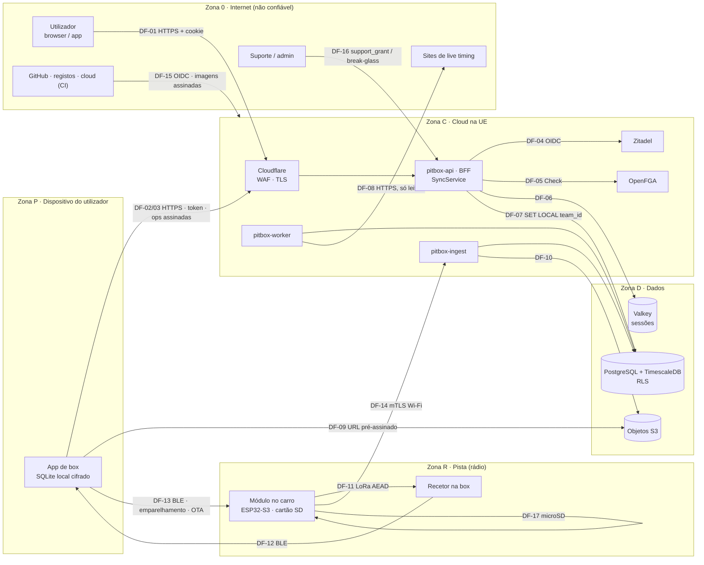

# Threat model do PitBox

- **Estado:** versão inicial (F0-07), 2026-10-12. Revisto no fim de cada fase do plano (`docs/03-plano-de-trabalho.md`, cartões contínuos).
- **Método:** STRIDE por elemento do diagrama de fluxo de dados (DFD) abaixo; privacidade (RGPD) em secção própria (o STRIDE não a cobre bem; para aprofundar, o método é o LINDDUN).
- **Ameaças:** [ameacas.md](ameacas.md) (uma linha por ameaça, com identificador, estado e prova).
- **Origem dos controlos:** arquitetura §5, §6, §8, §9, §10, §11, §12 e §14; ADRs em `docs/adr/`.

Este documento descreve **controlos**, não receitas de ataque: as ameaças `planeado` de prioridade alta descrevem-se ao nível da classe de problema.

## Ativos

| Ativo | Porque importa |
| --- | --- |
| Setups, garagem e estratégias de uma equipa | Vantagem competitiva: um rival com acesso a setups privados ganha com isso |
| Contas, sessões e tokens | Tomada de conta dá acesso a tudo o que a equipa vê |
| Telemetria e ficheiros do carro | Dados de desempenho; volume e formato controlados por um dispositivo |
| Firmware e chaves dos módulos | Código que fica anos no terreno e fala em rádio |
| Dados pessoais (nome, email, IP, nomes de pilotos, menores) | RGPD |
| Cadeia de fornecimento (código, imagens, dependências, CI) | Um componente comprometido chega a produção e aos dispositivos |

## Pressupostos e fora de âmbito

**Pressupostos** (dentro do contrato de cada fornecedor):
- Zitadel (IdP), Cloudflare, o fornecedor de cloud e o GitHub são confiáveis para as funções que lhes são atribuídas; as suas falhas de disponibilidade entram, as suas violações de integridade não.
- O dispositivo do utilizador (telemóvel, browser) não está comprometido por software malicioso com privilégios de sistema; um dispositivo **perdido ou roubado** está dentro do âmbito.
- Os mantenedores do repositório são o Nelson (dono). Contas de colaboradores futuros entram na revisão da v1.0.

**Fora de âmbito na v1.0:**
- Ataques físicos ao módulo além do secure boot, da cifra da flash e do firmware assinado (extração por sonda, glitching de tensão).
- Interferência de rádio deliberada (jamming) além de detetar a perda de pacotes: o módulo grava sempre no cartão.
- Ataques à cadeia de fornecimento dos fornecedores de cloud.
- Disponibilidade durante uma prova: o modo final é offline (ADR 0003); a perda de rede não é uma ameaça à corrida.

## Estado e prioridade

| Estado | Significado |
| --- | --- |
| `implementado` | Existe no `main` **e** há um ficheiro ou teste que se pode abrir (coluna "Prova") |
| `planeado` | Ainda não existe; o cartão do plano que o fecha vem na coluna "Prova". "Implementado" sem prova é `planeado` |
| `aceite` | Risco aceite, com o motivo e quem aceitou |

Prioridade (impacto × probabilidade, qualitativa): **A** (testar primeiro), **M**, **B**. Sem DREAD nem CVSS.

## Diagrama de fluxo de dados e fronteiras de confiança

### Fluxos

| ID | Fluxo | Fronteira que atravessa |
| --- | --- | --- |
| DF-01 | Browser ↔ BFF (cookie `__Host-`) | Internet → borda → API |
| DF-02 | App móvel ↔ API (token no Keychain/Keystore) | Internet → borda → API |
| DF-03 | Dispositivo offline ↔ `SyncService` (passe de 72 h, operações assinadas) | Dispositivo → API |
| DF-04 | API ↔ Zitadel (OIDC, JWKS) | Cloud → IdP |
| DF-05 | API ↔ OpenFGA (`Check`) | Cloud interno |
| DF-06 | API ↔ Valkey (sessões, tokens) | Cloud → dados |
| DF-07 | API, worker, ingest ↔ PostgreSQL (`pitbox_api`, RLS) | Cloud → dados |
| DF-08 | Worker ↔ sites de live timing (entrada hostil) | Cloud → Internet |
| DF-09 | App ↔ armazenamento de objetos (URL pré-assinado) | Internet → dados |
| DF-10 | Ingest ↔ objetos | Cloud → dados |
| DF-11 | Módulo → recetor (LoRa 868 MHz, ChaCha20-Poly1305) | Rádio (aberta a qualquer recetor) |
| DF-12 | Recetor ↔ app (BLE) | Rádio curto alcance → dispositivo |
| DF-13 | App ↔ módulo (BLE: emparelhamento, OTA, descarga) | Dispositivo → módulo |
| DF-14 | Módulo → `pitbox-ingest` (mTLS por Wi-Fi) | Internet → cloud |
| DF-15 | CI ↔ GitHub, registos de imagens, cloud (OIDC, sem chaves estáticas) | Cadeia de fornecimento |
| DF-16 | Suporte/admin → produção (`support_grant` ≤ 24 h, break-glass) | Humano → produção |
| DF-17 | Módulo ↔ cartão microSD (formato próprio com CRC) | Local ao módulo |

### Fronteiras de confiança

| Fronteira | Onde se aplica a verificação |
| --- | --- |
| Internet → borda → API | Cloudflare (WAF, TLS 1.3), rate limiting, limites de tamanho, deadlines; autenticação de origem |
| Browser ↔ BFF | Cookie `__Host-` HttpOnly/Secure/SameSite=Strict; nenhum token no JavaScript |
| Telemóvel ↔ API | Bearer token de 10 min; tokens no Keychain/Keystore |
| API ↔ IdP, OpenFGA, Valkey | Validação do token (`iss`, `aud`, `exp`, algoritmo fixo); `Check` por chamada; TLS e autenticação no Valkey em produção |
| API ↔ base de dados | `pitbox_api` sem `BYPASSRLS`; `SET LOCAL app.team_id`; FKs compostas |
| Dispositivo offline ↔ `SyncService` | Assinatura ECDSA por operação, passe de 72 h, revalidação da autorização atual |
| App ↔ recetor / módulo (BLE) | Emparelhamento com código de uso único (5 min); chave de sessão derivada |
| Módulo ↔ rádio | AEAD com número de sequência no nonce; rejeição de repetições |
| Worker ↔ live timing | Todo o HTML/JSON externo é entrada hostil: parsers com limites, fuzzing |
| App ↔ objetos ↔ ingest | URL pré-assinado limitado; ingest valida formato, CRC e autenticidade |
| CI ↔ GitHub, registos, cloud | Ações fixadas por SHA, permissões mínimas, OIDC, imagens assinadas |
| Suporte/admin ↔ produção | `support_grant` temporário, visível ao dono, na auditoria |
